# Greeting cards (fixed templates, no AI) — specification

A free feature: the user picks a greeting message, then turns it into a shareable picture ("card") by choosing one of a fixed set of graphic designs. Everything is drawn in code and runs on the device. There is no server, no account and no AI.

The paid AI card feature, if built later, can reuse the same sharing pipeline (capture a view as a PNG, then open the share sheet).

> **Status.** Implemented and covered by unit tests for the pure logic (text fitting, registry, export size). **Not yet tried on a real device**: image quality, font loading and the two-sheet navigation on iOS and Android still need a manual check. The images in this document are mockups rendered from the design files, not screenshots of the app.

## 1. User flow

1. Open a birthday for editing and tap **Scrivi auguri** (already built: message templates).
2. Pick or edit the message, then tap **Crea cartolina**.
3. Card screen: preview, **Stile** strip, **Formato** (Quadrato / Storia), **Condividi cartolina**.
4. The share sheet opens with a PNG image.

Rules:

- The card uses the message text as it is at that moment, including the user's edits.
- When a template is selected, its recipient-name salutation is removed because the card displays the name separately; subsequent user edits are preserved as written.
- Designs recommended for the chosen tone come first in the strip; all other designs follow.
- Designs that show the age (`needsAge`) are hidden when the birth year is unknown.
- Gender-agreement phrases show both alternatives with `/` when recipient gender is unknown; the user can choose or edit the wording.
- The card labels follow the message language (Italian or English).
- If the message does not fit the card even at the smallest font size, an inline warning asks the user to shorten it or pick another style. Sharing is still allowed.

## 2. Formats and export

| Format | Logical size (px) | Exported image | Use |
|--------|------------------|----------------|-----|
| `square` | 340 × 340 | 1080 × 1080 PNG | Chats, feeds |
| `story` | 270 × 480 | 1080 × 1920 PNG | Stories (9:16) |

- Every design is drawn at the logical size and shown on screen at that size (no scaling on screen). The image is captured at 1080 px wide with `react-native-view-shot` (`captureRef`, `format: 'png'`, `result: 'tmpfile'`, `width`/`height` set to the export size) and passed to `expo-sharing` (`mimeType: 'image/png'`, `UTI: 'public.png'`).
- The card view must have `collapsable={false}` so that Android keeps the view in the hierarchy and it can be captured.
- If file sharing is not available on the device, the user sees an error dialog.
- **Story safe zones.** Messaging apps place their own interface over the top and bottom of a story. Keep text at least about 70–80 px (logical) from the top edge and 96 px from the bottom edge, as the current designs do.

## 3. Dependencies

Installed with `npx expo install` so the versions match Expo SDK 52:

| Package | Purpose |
|---------|---------|
| `react-native-svg` | Vector decorations (confetti, balloons, hills, shapes). Small and recolourable, no image files in the bundle |
| `react-native-view-shot` | Capture the card view as a PNG |
| `expo-sharing` | Open the system share sheet with the file |
| `expo-font` | Load the fonts below |
| `@expo-google-fonts/fraunces`, `/bricolage-grotesque`, `/dm-sans` | The three typefaces |

Fonts: Fraunces Bold (serif), Bricolage Grotesque ExtraBold and Medium (display), DM Sans Regular and Bold (body and labels). If loading fails, the card falls back to system fonts instead of blocking the screen.

## 4. Code layout

```
src/cards/
├── types.ts          # CardFormat, CARD_SIZES, EXPORT_WIDTH, CardRenderProps, CardDesign
├── registry.ts       # CARD_DESIGNS list, designsForTone(), messageFits(), getDesign()
├── fit.ts            # fitText(), estimateLines(): pure, tested
├── strings.ts        # Fixed labels in Italian and English
├── fonts.ts          # FONT names + useCardFonts()
├── CardText.tsx      # CardMessage (auto-fit), CardName (one line, shrinks), CardLabel
├── exportCard.ts     # exportSize(), shareCardImage()
└── designs/          # One file per design
src/components/CardPickerModal.tsx   # The card screen (opened from MessagePickerModal)
```

### Data contract

```ts
interface CardRenderProps {
  name: string;          // first name, from getFirstName()
  message: string;       // text shown on the card (may be edited by the user)
  format: 'square' | 'story';
  locale: 'it' | 'en';   // for the fixed labels
  age?: number;          // age being turned; used only by designs with needsAge
}

interface CardDesign {
  id: string;            // never change or reuse after release
  title: string;
  tones: Tone[];         // tones the design is recommended for
  needsAge?: boolean;    // hidden when the birth year is unknown
  swatch: string;        // colour of the thumbnail in the style strip
  messageBox: Record<CardFormat, FitOptions>;  // area reserved for the message
  Component: ComponentType<CardRenderProps>;
}
```

### Text fitting

The message font size is the largest whole number of px between `maxFontSize` and `minFontSize` for which the estimated text height fits in the message box. The estimate wraps by words and assumes an average character width of 0.52 × the font size and a line height of 1.45 × the font size (some designs use 1.5). It is a conservative estimate, not a measurement. `fits: false` only drives the warning. The name is always one line and uses `adjustsFontSizeToFit` (down to 50%).

A unit test checks that every message in the Italian and English libraries fits every design in both formats. When a new message or design is added and the test fails, enlarge the message box or shorten the message.

### Fixed labels

| Key | Italian | English | Used by |
|-----|---------|---------|---------|
| `birthday` | Buon compleanno | Happy birthday | Coriandoli, Carta e inchiostro, Blocchi blu |
| `manyWishes` | Tantissimi auguri | Best wishes | Alba |
| `cheers` | Auguri | Hooray | Tipografica (big word, keep it short) |
| `years` | anni | years | Candelina |

## 5. Design catalog

Eight designs. Sizes below are logical px. "Message box" is the area reserved for the message, per format.

### 5.1 Coriandoli — warm

| Square | Story |
|--------|-------|
| 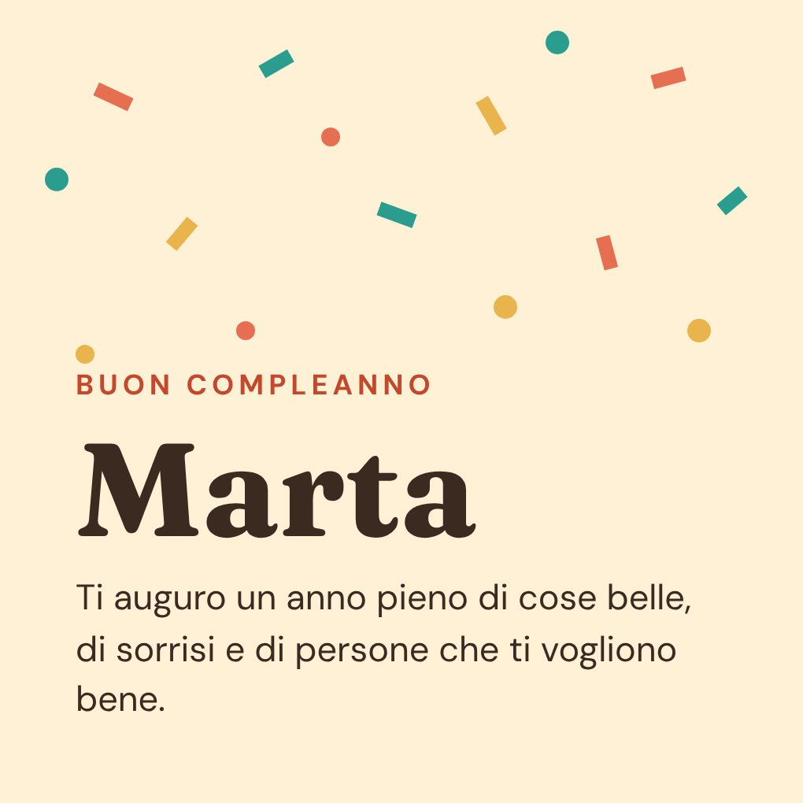 | 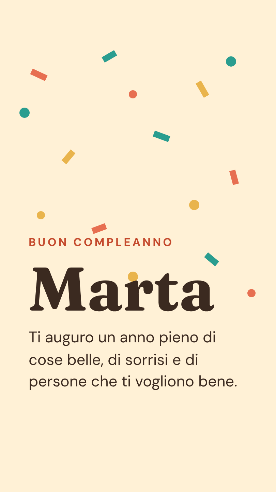 |

- **Palette:** background `#FFF1D6`, text `#3B2A20`, label `#C4492C`, confetti `#E76F51` `#2A9D8F` `#E9B44C`.
- **Type:** label DM Sans Bold 12 (story 11) uppercase, spacing 2; name Fraunces Bold 56 (story 60); message DM Sans.
- **Layout:** confetti (small rotated rectangles and dots) in the upper part; text block at the bottom (padding 32; story 28 with 96 at the bottom).
- **Message box:** square 276 × 66, story 214 × 94; font 15 down to 11.

### 5.2 Alba — warm

| Square | Story |
|--------|-------|
| 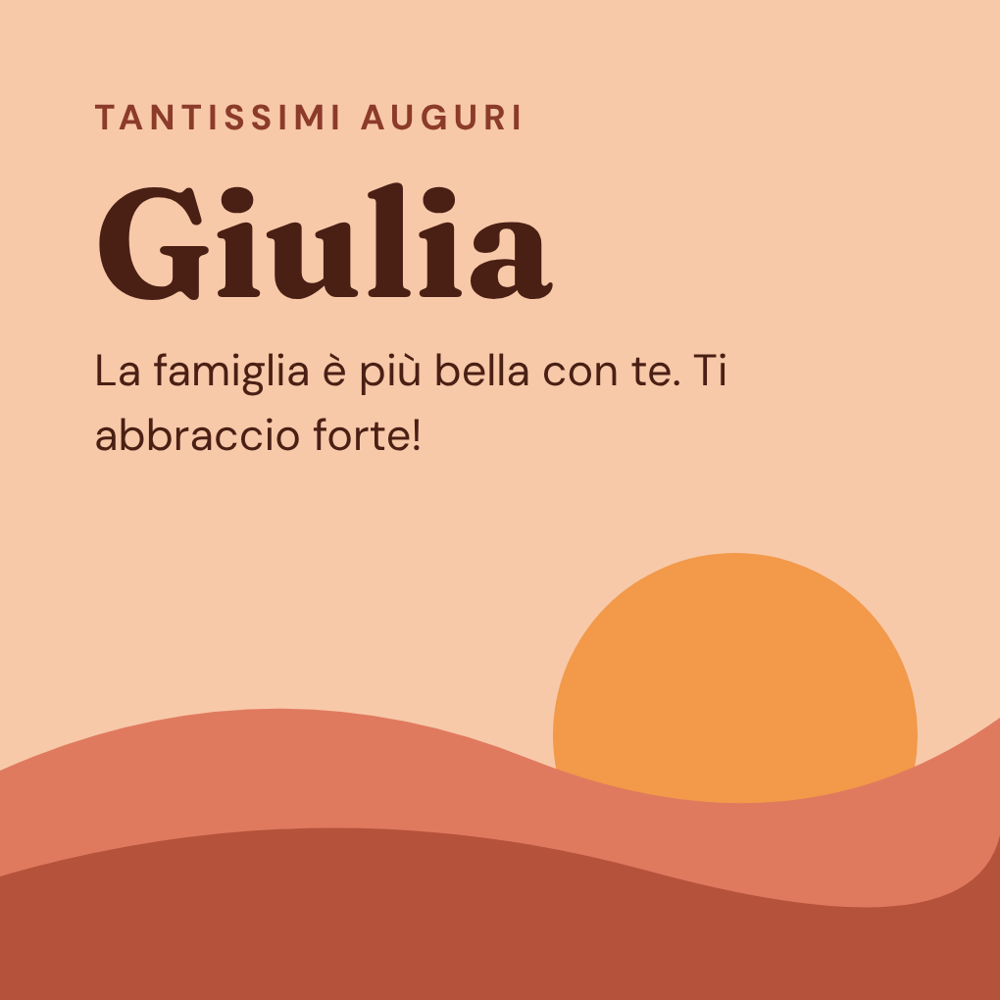 | _no mockup; built from the square design_ |

- **Palette:** background `#F7C9A9`, text `#4A1F14`, label `#8C3B2B`, sun `#F2994A`, hills `#E07A5F` and `#B5523B`.
- **Type:** label DM Sans Bold uppercase; name Fraunces Bold 52 (story 60).
- **Layout:** text at the top; sun and two hills at the bottom (sun lower in the story format).
- **Message box:** square 276 × 66, story 214 × 120.
- **Label:** `manyWishes`.

### 5.3 Palloncini — funny

| Square | Story |
|--------|-------|
| 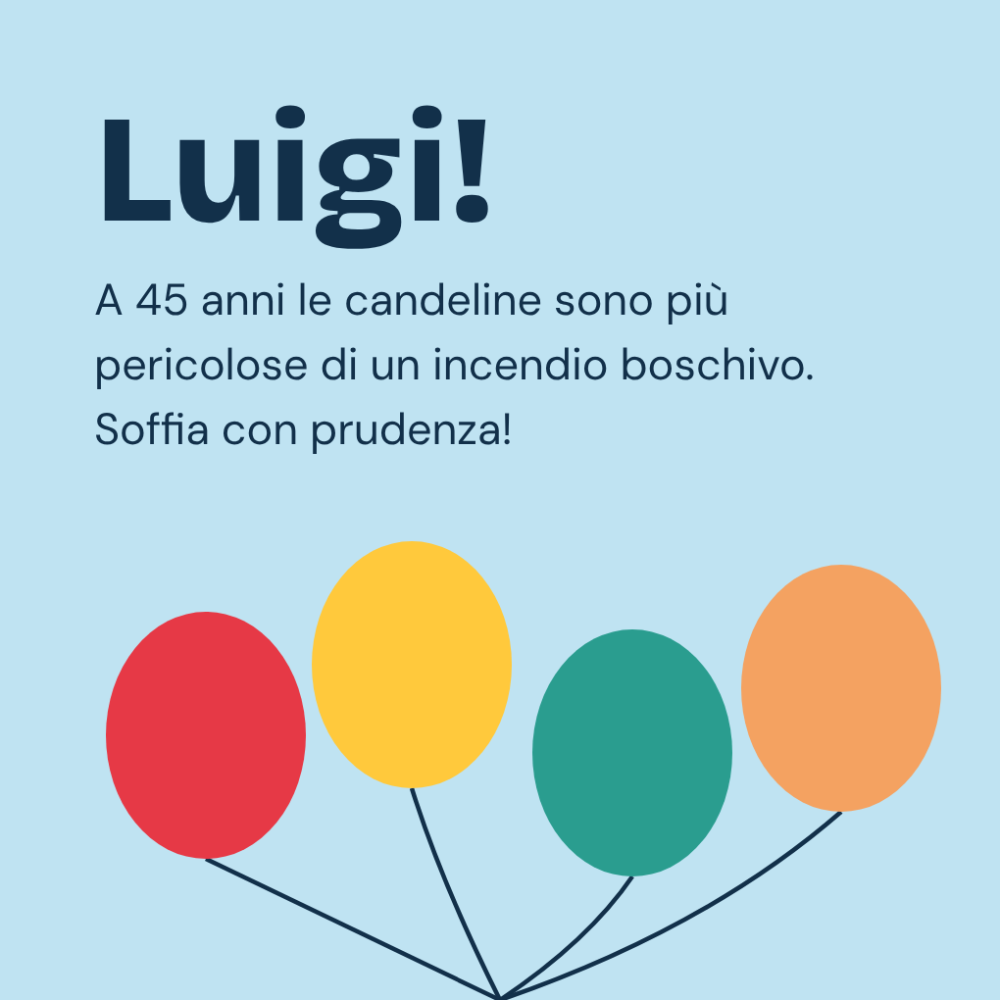 | 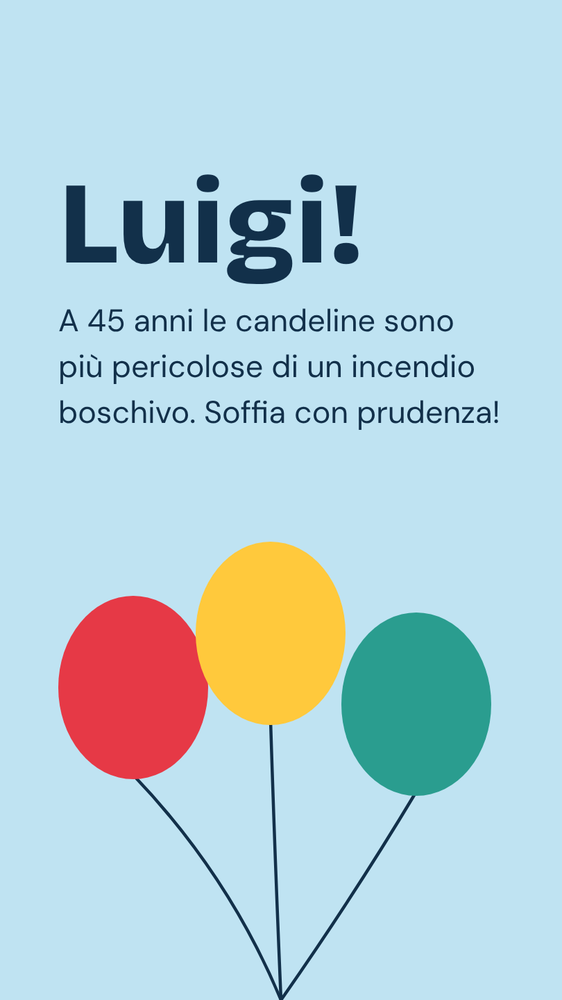 |

- **Palette:** background `#BFE3F2`, text `#12304A`, balloons `#E63946` `#FFC93C` `#2A9D8F` `#F4A261` (story shows the first three).
- **Type:** name Bricolage Grotesque ExtraBold 52 (story 56), followed by "!"; message DM Sans.
- **Layout:** text at the top; balloons with strings converging at the bottom centre.
- **Message box:** square 276 × 80, story 214 × 100.

### 5.4 Torta pop — funny

| Square | Story |
|--------|-------|
| 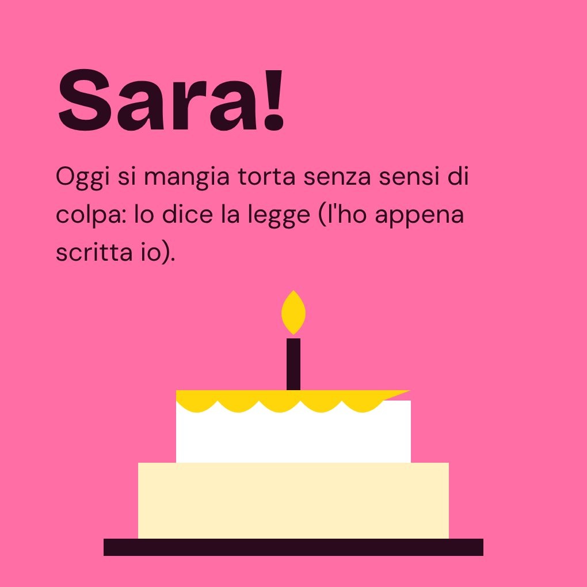 | _no mockup; the cake is moved down by 80 px and left by 35 px_ |

- **Palette:** background `#FF6FA5`, text and plate `#2B0A1E`, icing and flame `#FFD60A`, layers `#FFF1C1` and `#FFFFFF`.
- **Type:** name Bricolage Grotesque ExtraBold 52 (story 56), followed by "!".
- **Layout:** text at the top; flat cake with one candle at the bottom.
- **Message box:** square 276 × 66, story 214 × 99.

### 5.5 Carta e inchiostro — formal

| Square | Story |
|--------|-------|
| 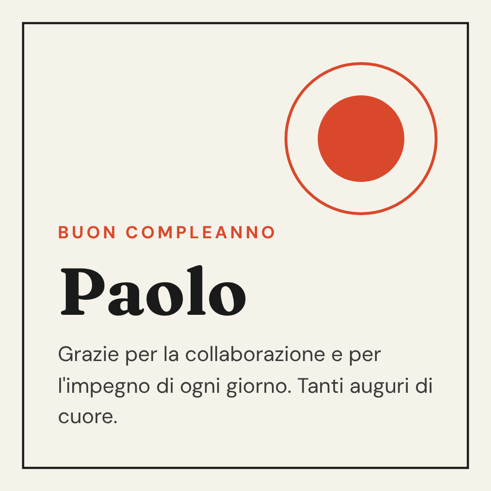 | _no mockup; built from the square design_ |

- **Palette:** background `#F5F2EA`, text `#1A1A1A`, message `#3A3A3A`, accent `#D9482B`.
- **Type:** label DM Sans Bold uppercase; name Fraunces Bold 46 (story 52); message line height 1.5.
- **Layout:** thin black frame inset 16 px; a red ring with a solid dot at the top right; text at the bottom.
- **Message box:** square 260 × 70, story 206 × 130.

### 5.6 Blocchi blu — formal

| Square | Story |
|--------|-------|
| 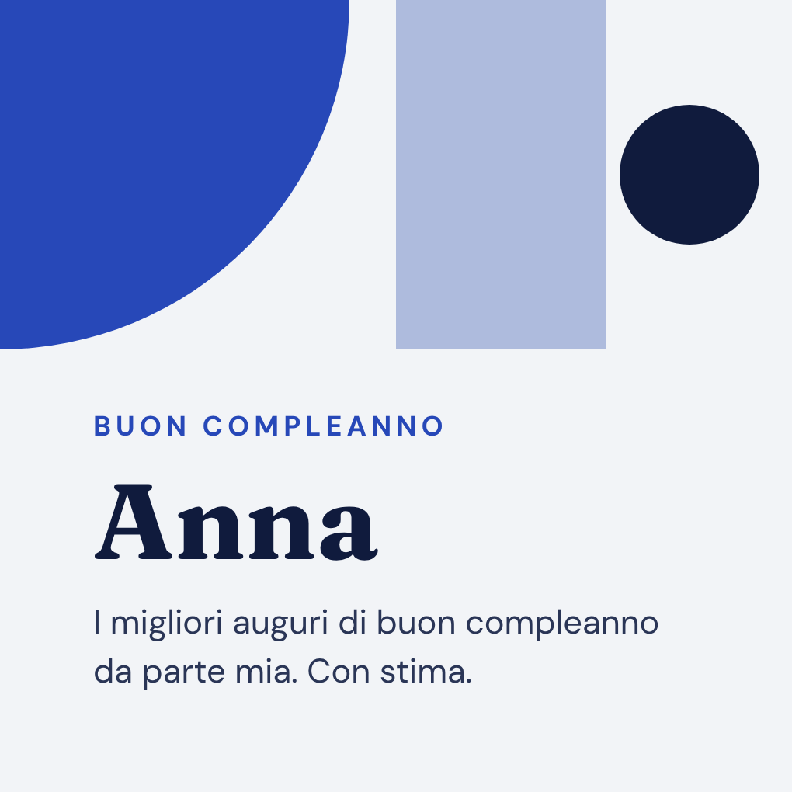 | 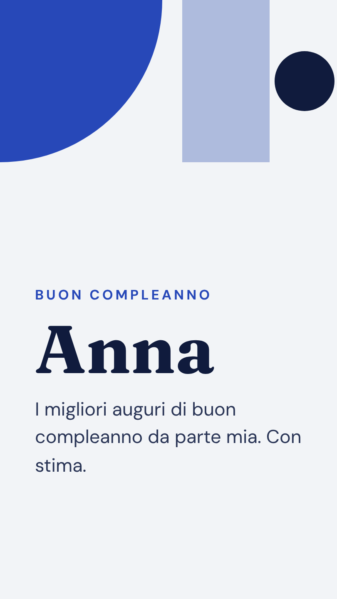 |

- **Palette:** background `#F2F4F7`, cobalt `#2748B8`, sky `#AEBBDD`, navy `#101B3D`, message `#2A3556`.
- **Type:** label DM Sans Bold uppercase cobalt; name Fraunces Bold 46 (story 54); message line height 1.5.
- **Layout:** three flat shapes at the top (quarter circle, rectangle, circle); text at the bottom.
- **Message box:** square 260 × 70, story 214 × 150.

### 5.7 Tipografica — short

| Square | Story |
|--------|-------|
| 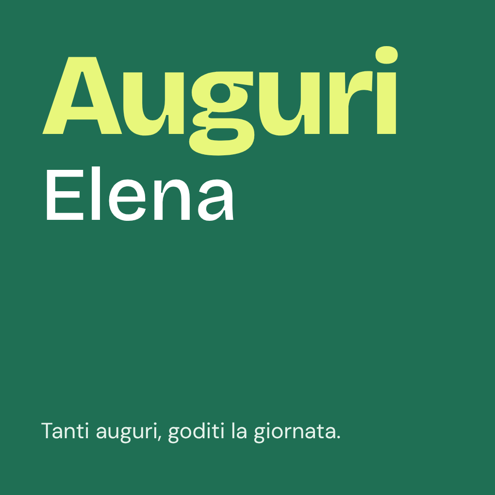 | 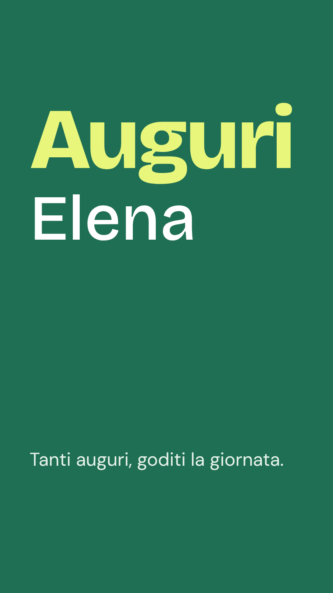 |

- **Palette:** background `#1F6F54`, big word `#E8F77B`, name `#FFFFFF`, message `#E7F3EC`.
- **Type:** big word Bricolage Grotesque ExtraBold 80 (story 70), letter spacing −3; name Bricolage Grotesque Medium 52.
- **Layout:** big word and name at the top left, message pinned to the bottom.
- **Message box:** square 284 × 120, story 222 × 150.
- **Label:** `cheers` (one short word).

### 5.8 Candelina — short, needs age

| Square | Story |
|--------|-------|
| 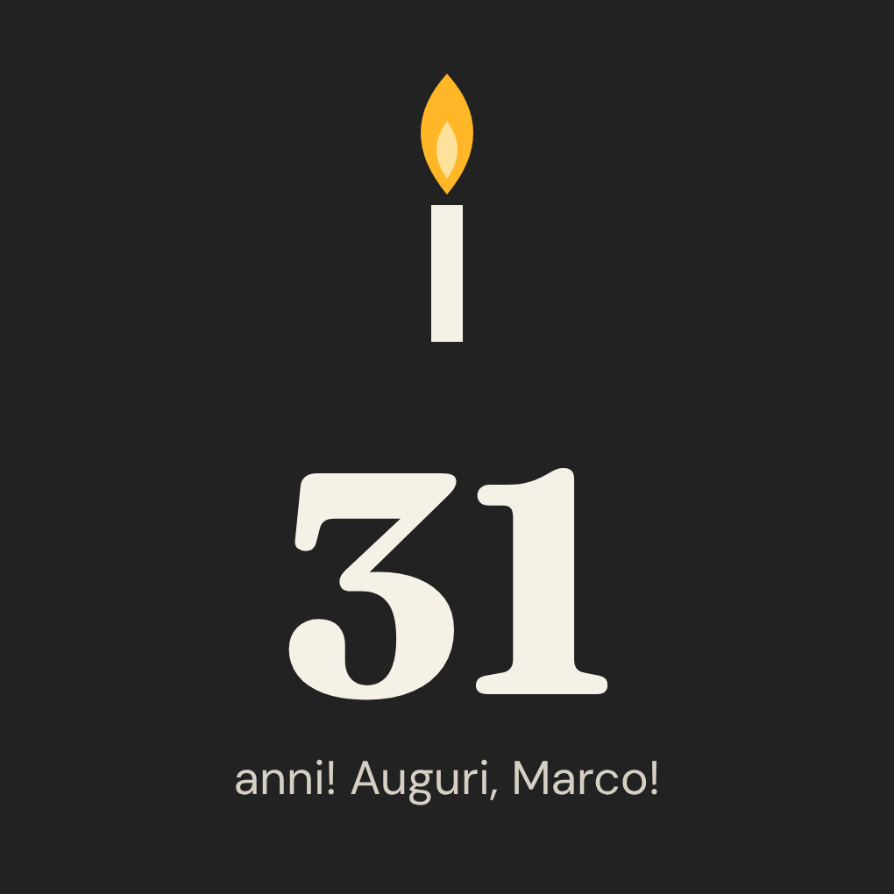 | _no mockup; candle starts 70 px from the top_ |

- **Palette:** background `#222222`, age `#F6F1E7`, secondary text `#D6D0C4`, flame `#FFB627` and `#FFE29A`.
- **Type:** age Fraunces Bold 80 (story 88); "ANNI" / "YEARS" DM Sans Bold 14, spacing 3; message centred.
- **Layout:** candle at the top centre, big age and label, recipient name, then the message.
- **Message box:** square 276 × 79, story 214 × 73.
- **Hidden** when the birth year is unknown (`needsAge`).
- **Difference from the mockup:** the mockup shows "anni! Auguri, Marco!" under the number. The app shows the age, the label "ANNI" and then the selected message, so the age can appear twice with the short template "{age} anni! Auguri, {name}!". See open questions.

### Overview

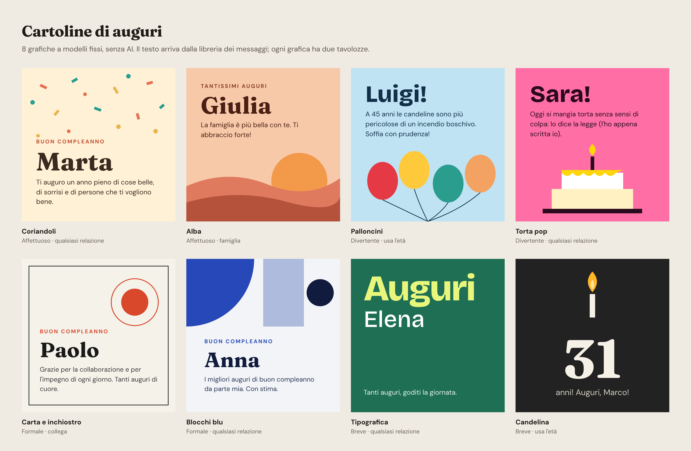

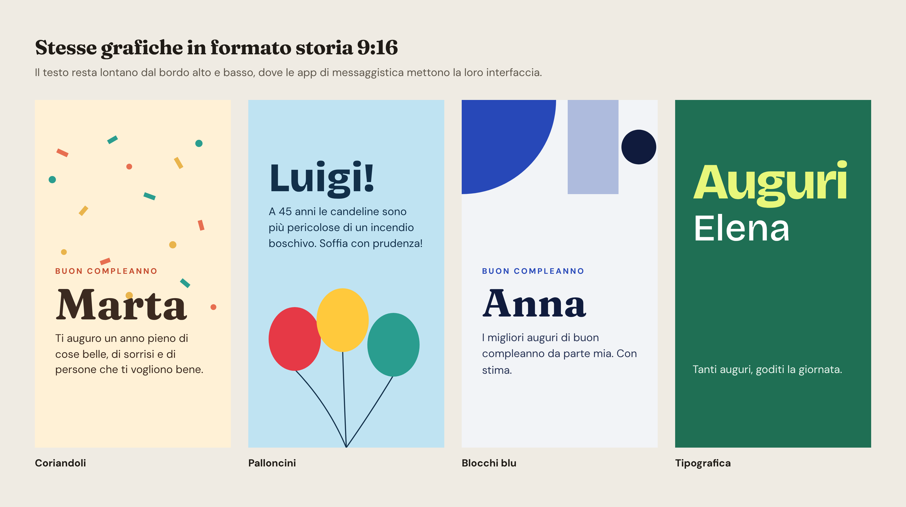

The gallery image says each design has "two palettes". That is a plan, **not implemented**: each design currently has a single colour scheme.

## 6. Adding a design

1. Create `src/cards/designs/<Name>.tsx` exporting a `CardDesign` with a **new** id. Draw it for both formats at the logical sizes in section 2.
2. Define `messageBox` for both formats and keep the text clear of decorations and story safe zones.
3. Use `CardName`, `CardMessage` and `CardLabel` from `CardText.tsx`, and labels from `strings.ts` (add a new key to both languages if needed).
4. Add the design at the **end** of `CARD_DESIGNS` in `registry.ts`.
5. Run `npm test`. The "all library messages fit every design" test must pass.
6. Check it on a device with a short and a long message, a long name, and (if `needsAge`) with and without a birth year.

## 7. Open questions and known limits

- **Emoji in messages.** Shipped greeting templates contain no emoji. User-added emoji in edited messages are preserved as entered; text fitting does not account for their width.
- **Candelina and the age.** Decide whether the card should hide the age that already appears in the message, or whether this design should always use a fixed phrase.
- **Names.** Compound first names ("Maria Grazia") show only the first word. Very long names shrink to at most 50% of the size.
- **Estimated fitting.** The fitting is an estimate. If the warning appears too early or too late on real devices, tune the ratios in `fit.ts`.
- **Story variants** of Alba, Torta pop, Carta e inchiostro and Candelina exist only in code and have no mockup yet.
- **Accessibility.** The card is an image once shared. The text is also what the user shares in the message screen, so nothing is lost for screen-reader users in the app itself.
