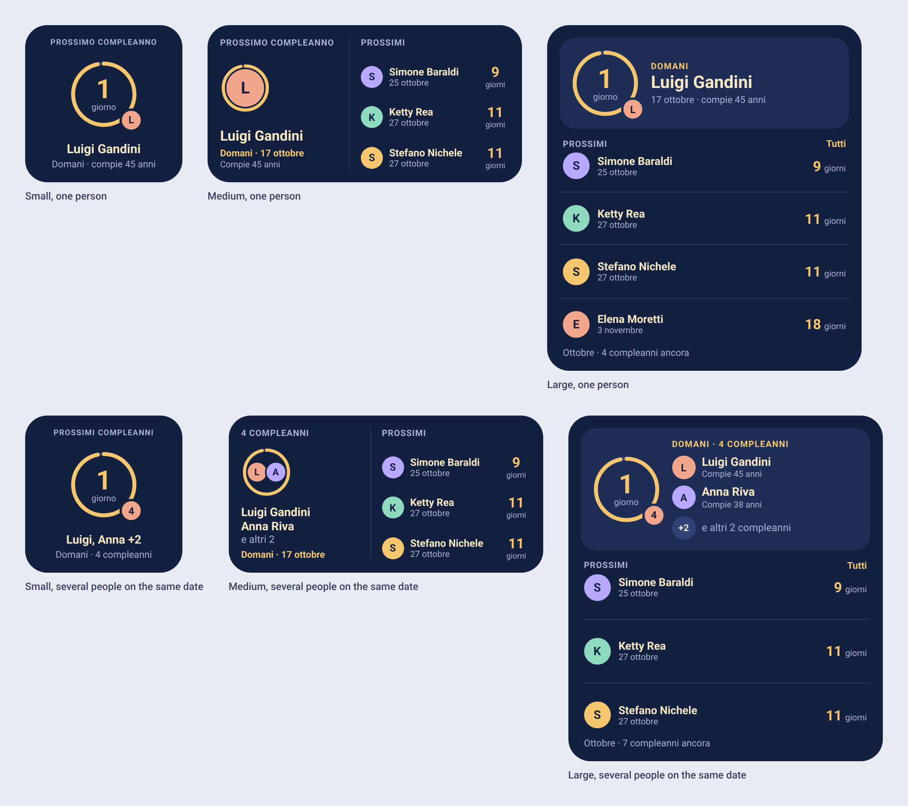
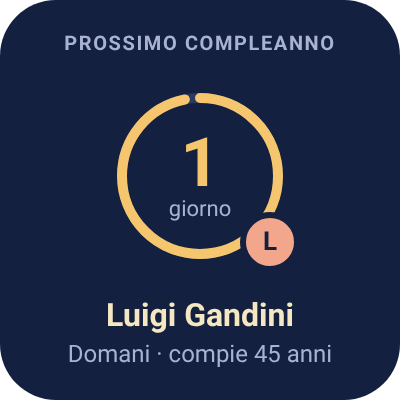
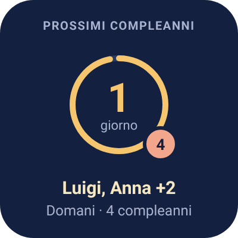
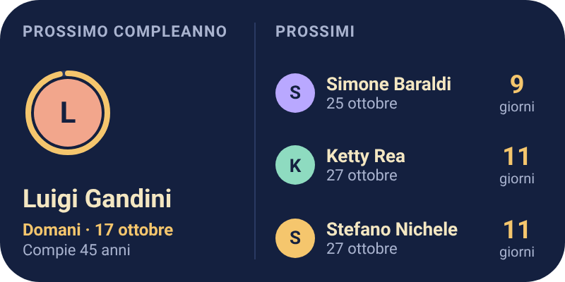
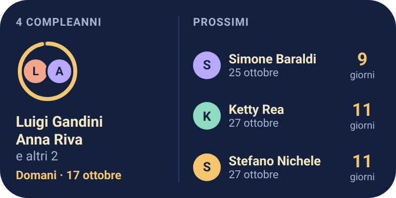
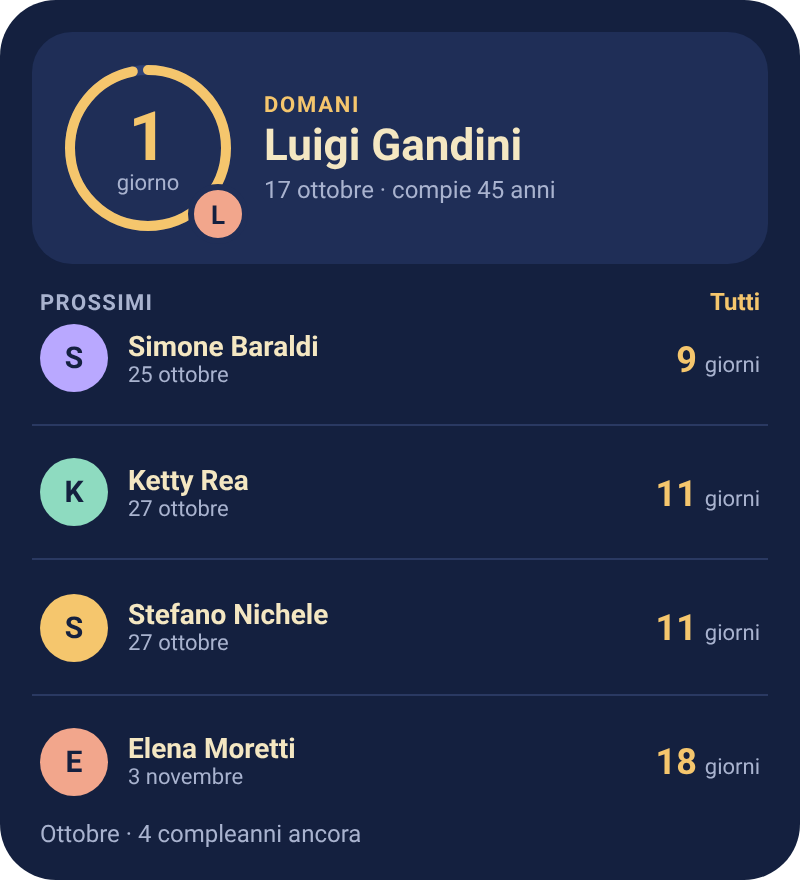
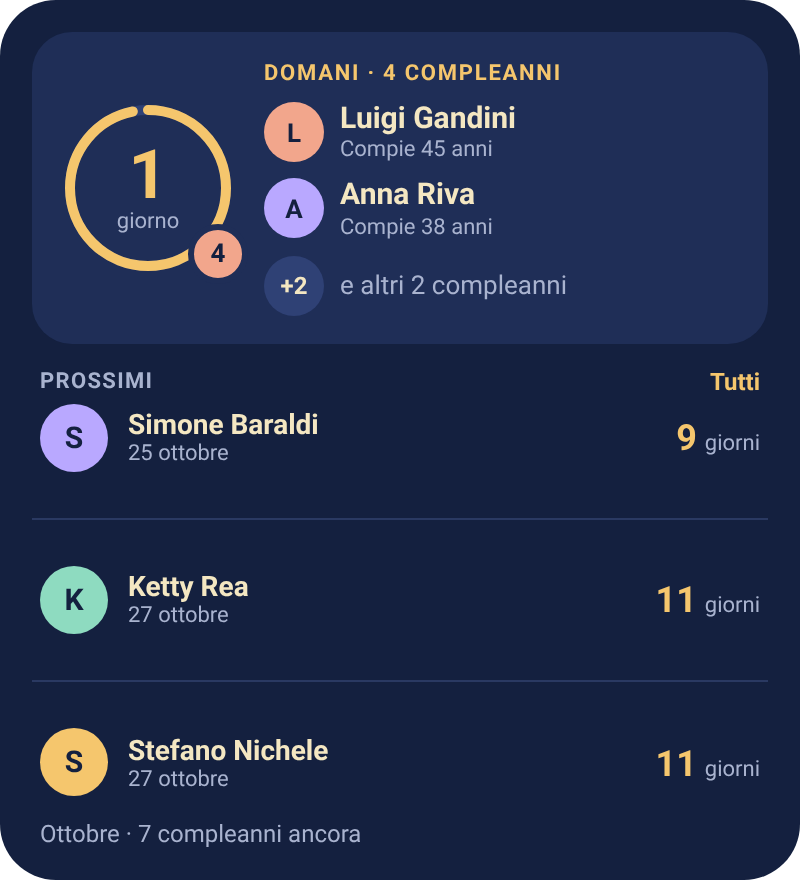

# Home-screen Widget — Design Spec (Android, React Native / Expo)

Status: draft · Last updated: 2026-10-16 · Scope: dark theme only

This document turns the widget mockups ("Widget compleanni – nuovo layout" design canvas) into an implementation spec. The mockups show the visual intent; this spec is the source of truth for sizes, colors, text, data rules and edge cases. Names and dates in the mockups are sample data.

## 1. Scope

**In scope**

- One **responsive** widget that adapts to any size, using three layout presets: small, medium, large.
- Dark theme only (navy background, cream text, amber accent).
- Two content states for the next birthday: **one person** and **several people on the same date**.
- Tapping the widget opens the app.

**Out of scope (for now)**

- Light theme variant.
- A special "birthday today" design. "Today" reuses the normal layout (see 5.2).
- Action buttons inside the widget (e.g. "Create card", "Write message", "Add birthday").
- iOS widgets (WidgetKit requires Swift/SwiftUI and a separate target).

## Visual reference

The images below are rendered from the design mockups (dark theme only). They show the three layout presets, each with one person and with several people on the same date. Names, dates and ages are sample data. Mockup pixels are proportional design units (see section 2).



| Preset | One person | Several people on the same date |
|--------|-----------|----------------------------------|
| Small |  |  |

**Medium**





**Large**

| One person | Several people on the same date |
|-----------|----------------------------------|
|  |  |

Notes on the images:

- The ring in the images is drawn at the "1 day left" state (about 97% filled).
- The medium widget shows 3 upcoming rows and the large widget 4 (one person) or 3 (several people). The responsive rules in 2.1 decide how many rows fit.
- Image files live in `docs/mockups/` next to this document: `00-overview.png`, `01-small.png`, `02-medium.png`, `03-large.png`, `04-small-same-date.png`, `05-medium-same-date.png`, `06-large-same-date.png`.

## 2. Widget sizes

The home-screen widget supports only two layouts: 2 × 2 and 4 × 2. Android uses horizontal resizing, with a 2 × 2 minimum and a 4 × 2 target. The provider allows up to 280 dp wide to accommodate launcher grid rounding; launchers may expose intermediate widths between those bounds.

| Preset | Mockup size | Typical use | Content |
|--------|-------------|-------------|---------|
| 2 × 2 | 200 × 200 | Compact | Next birthday only |
| 4 × 2 | 400 × 200 | Wide | Next birthday on the left + the next three birthdays on the right |

Mockup pixels are proportional design units, not final dp. Implement with flexible layouts and test several widget sizes.

### 2.1 Responsive behavior

**Sizing.** Declare a 2 × 2 minimum and default, a 280 dp maximum width, and horizontal-only resize mode in Android's widget provider. The rendering switches between compact and wide based on the available width.

| Condition | Preset |
|-----------|--------|
| Narrow layout | 2 × 2 hero only |
| Wide layout | 2 × 2 hero + three upcoming rows |

**Fluid rules inside a preset.** Text sizes stay fixed (in sp); the widget gives up content, not legibility.

- **4 × 2**: the hero occupies the left side; three compact upcoming rows on the right retain the avatar, name, date, and accent day count.
- **2 × 2**: centered hero with a smaller ring; the name and relative-day line may truncate before the countdown is reduced.

**What goes first when space runs out** (last item is dropped first):

1. The next birthday: ring, names and relative-day label
2. The day count
3. Upcoming rows (the farthest row is dropped first)
4. Secondary lines: dates and ages in rows, then the hero's age line
5. No monthly footer is shown.

**Re-rendering.** When the user resizes the widget the task re-renders using the current dimensions. On iOS, only the small and medium home-screen families are offered; lock-screen accessory families remain available.

All widgets have a corner radius of **28 dp** and **16 dp** inner padding (small: 14–16 dp).

## 3. Design tokens

### Colors

| Token | Hex | Use |
|-------|-----|-----|
| `bg` | `#14203F` | Widget background |
| `bgCard` | `#1F2E57` | Hero card in the large widget |
| `ringTrack` | `#2A3962` | Ring track (small, medium), dividers |
| `ringTrackCard` | `#2F4175` | Ring track inside the large hero card, "+N" chip |
| `accent` | `#F5C66D` | Ring progress, day numbers, relative-day label, "All" link |
| `text` | `#F4E7C2` | Names, main text |
| `textMuted` | `#A9B3CF` | Labels, dates, secondary text |
| `onAvatar` | `#14203F` | Initial inside an avatar |
| `avatarCoral` | `#F2A68C` | Avatar color 1, count badge |
| `avatarLilac` | `#B9A8FF` | Avatar color 2 |
| `avatarMint` | `#8EDBC0` | Avatar color 3 |
| `avatarSand` | `#F5C66D` | Avatar color 4 |

Avatar color is chosen deterministically from a stable hash of the person's id, so it never changes between refreshes.

### Typography (system font, Roboto on Android)

| Element | Size | Weight | Notes |
|---------|------|--------|-------|
| Section label ("Prossimi") | 11 | Bold | Uppercase, letter-spacing about 0.06em, `textMuted` |
| Small widget label | 10 | Bold | Uppercase, letter-spacing about 0.08em |
| Hero name — small | 16 | Bold | 1 line |
| Hero name — medium | 18 | Bold | Up to 2 lines |
| Hero name — large (single) | 22 | Bold | Up to 2 lines |
| Hero names — several people | 15 | Bold | 1 line each, ellipsis |
| Relative-day line ("Domani · 17 ottobre") | 12 | Bold | `accent` |
| Secondary line (age, date) | 11 | Regular | `textMuted` |
| List name — medium | 13 | Bold | 1 line, ellipsis |
| List name — large | 14 | Bold | 1 line, ellipsis |
| Days number in a list row | 18 | Bold | `accent` |
| "giorni" next to the number | 10 (medium) / 11 (large) | Regular | `textMuted` |
| Ring center number | 34 | Bold | `accent`, in the 88 ring (small, large) |
| Ring center label ("giorno") | 11 | Regular | `textMuted` |

Minimum text size in the widget: 10 sp. Use `sp` for text so system font scaling applies; check that nothing breaks at larger font sizes (see section 8).

### Shapes

| Element | Spec |
|---------|------|
| Ring (2 × 2) | 88 diameter, radius 39, stroke 5, round caps |
| Ring (4 × 2 hero) | 64 diameter, radius 28, stroke 4, round caps |
| Ring start | 12 o'clock, clockwise |
| Avatar (upcoming list) | 20–22 diameter, centered initial, bold |
| Count badge on ring | 30 diameter, `avatarCoral`, 3 px border in the surface color, bottom-right of the ring |
| Divider | 1 px, `ringTrack` |

## 4. Layouts

### 4.1 Small (2 × 2) — centered column

From top to bottom, centered: label, ring, name block.

1. **Label**: "Prossimo compleanno" (plural "Prossimi compleanni" when several people).
2. **Ring** (88): progress arc, center shows the number of days and "giorno"/"giorni".
   - One person: bottom-right badge with the **first letter** of the name, avatar color.
   - Several people: bottom-right badge with the **number of people** (e.g. "4"), coral.
3. **Name block**:
   - One person: name (16 bold), then "Domani · compie 45 anni" (12 muted; the age part only if the birth year is known).
   - Several people: first names (see 5.3), then "Domani · 4 compleanni".

### 4.2 Wide (4 × 2) — hero and upcoming list

The left panel repeats the 2 × 2 hero in a narrower column with a 64 dp ring. A vertical divider separates it from the three upcoming rows. Each compact row keeps the avatar, name and date, with the day count aligned at the right; the unit label may be omitted when width is constrained.

## 5. Data rules

### 5.1 Selecting what to show

1. Compute each person's next occurrence and `daysLeft` (same logic as the app, including the 29 Feb rule: celebrated on 28 Feb in non-leap years).
2. **Merge duplicates**: entries with the same normalized name (trimmed, case-insensitive) and the same day/month are shown once. This removes duplicates such as the same contact imported twice.
3. Sort by `daysLeft`, then by name (Italian collation, A–Z).
4. **Group by date.** The first group is the **hero**. All later people (not groups) form the upcoming list. The hero group is never repeated in the list.

### 5.2 Relative-day label and ring

| `daysLeft` | Label | Ring center |
|-----------|-------|-------------|
| 0 | "Oggi" | Text "Oggi" instead of number + "giorno"; ring full |
| 1 | "Domani" | "1" + "giorno" |
| 2 to 30 | "Tra N giorni" (or the date) | "N" + "giorni" |
| over 30 | Date, e.g. "3 dicembre" | "N" + "giorni"; ring empty |

Ring progress = `clamp((30 − daysLeft) / 30, 0, 1)`.

"Today" uses the same layout as any other day. There is no special design for it.

### 5.3 Several people on the same date

- Show the **total count** and only the **first 2 people** (alphabetical order).
- Everyone beyond 2 is summarized as "e altri N" (medium) or "+N … e altri N compleanni" (large), where N = total − 2.
- Count badge on the small widget shows the total.
- Small widget names: 2 people → "Luigi e Anna"; 3 or more → "Luigi, Anna +N" (first names, N = total − 2).
- With exactly 2 people the "others" row is not shown.

### 5.4 Age

"Compie N anni" appears only when the birth year is known, and the line is omitted entirely when it is not. With several people it is shown per person (large widget only).

### 5.5 Large widget footer

Text: "<Month> · N compleanni ancora". N counts all birthdays (after merging) whose next occurrence falls in the current calendar month and is today or later, including the hero group.

### 5.6 Names and dates

- Dates: lowercase Italian month name, e.g. "17 ottobre". Use the device locale when localization is added.
- Initials: first letter of the first word of the name, uppercased.
- Long names: one line with an ellipsis, except the single-person hero in the medium and large widgets (up to 2 lines).

### 5.7 Empty and error states

| Situation | Display |
|-----------|---------|
| No birthdays saved | Centered "Nessun compleanno salvato" with a muted line "Apri l'app per aggiungerne uno" |
| Data cannot be read | Same as empty, plus a muted "Tocca per aprire l'app" |
| Fewer upcoming people than rows | Show the rows available; no placeholders |

## 6. Behavior

- **Tap** anywhere on the widget opens the app on the home screen. (Later: tapping a row can open that person's detail through a deep link.)
- **Refresh**:
  - When the user adds, edits or deletes a birthday in the app, the app requests a widget update.
  - At or just after midnight (local time), so that "Domani" turns into "Oggi" and day counts change.
  - On device boot and on time-zone or date change.
  - Android limits periodic updates (the system minimum is about 30 minutes), so a periodic update should only be a fallback.
- Widgets must not run network requests. Everything is computed from local data.

## 7. Implementation notes (React Native / Expo)

> I have not built or run any of this. Verify APIs against the documentation of the library version you install.

### 7.1 Recommended approach

Android widgets cannot render arbitrary React Native views. A widely used option for Expo projects is the library **`react-native-android-widget`**, which lets you describe the widget with a small set of primitives (flex containers, text, images, SVG, overlap/stack, lists) and renders it into native widget views. Expo support is through a **config plugin**, so you need a **development build or prebuild** — widgets do **not** work in Expo Go.

Typical steps:

1. Install the library and add its config plugin to `app.json`, declaring one widget per size (name, label, description, minimum and target cell size, preview image, update period).
2. Register a **widget task handler** in the app entry point. The system calls it (also in the background) with the widget name, size and the action (added, updated, clicked, resized).
3. Read the current widget size passed to the handler (check the library documentation for the exact field and unit), pick the preset with the breakpoints in 2.1 and compute how many rows fit. Then load the saved birthdays from AsyncStorage (key `@compleanni/birthdays:v1`, or the migrated key once events are introduced), build the view model (7.2) and render the matching widget.
4. Call the library's update function from the app after every create, edit or delete.
5. Schedule a daily refresh around midnight.

### 7.2 Suggested structure

```
src/widget/
├── buildWidgetModel.ts      # pure function: birthdays + today -> view model
├── buildWidgetModel.test.ts # unit tests (see below)
├── theme.ts                 # tokens from section 3
├── SmallWidget.tsx
├── MediumWidget.tsx
├── LargeWidget.tsx
├── Ring.ts                  # builds the SVG string for the progress ring
└── widgetTaskHandler.tsx    # registered at app entry
```

Suggested view model (all three widgets consume the same data):

```ts
interface WidgetPerson { id: string; name: string; initial: string; avatarColor: string; turningAge?: number; }

interface WidgetModel {
  state: 'empty' | 'ready';
  hero?: {
    daysLeft: number;
    relativeLabel: string;   // "Oggi", "Domani", "Tra 9 giorni"
    dateLabel: string;       // "17 ottobre"
    ringProgress: number;    // 0..1
    totalCount: number;      // people on that date
    people: WidgetPerson[];  // at most 2
    hiddenCount: number;     // totalCount - people.length
  };
  upcoming: { person: WidgetPerson; dateLabel: string; daysLeft: number }[];
  monthRemainingCount: number;
  monthLabel: string;        // "Ottobre"
}
```

Keep this logic in a pure function so it can be tested without a device. It should receive the number of upcoming rows that fit (computed from the widget size) and return at most that many.

### 7.3 Rendering notes

- **Ring**: draw it as an SVG (track circle + progress arc with `stroke-dasharray`) and render it through the library's SVG primitive. Use the dimensions in section 3. Dash length = circumference × progress.
- **Overlapping avatars** (medium, several people) and the **badge on the ring**: use the library's overlap/stack primitive with absolute offsets, or include the badge in the same SVG.
- **Rounded corners**: use the widget container's background and radius; check that the launcher does not add its own mask.
- **Fonts**: system font only; custom fonts are not available in widgets. Letter-spacing on the uppercase labels may not be supported; if not, drop it.
- **Text overflow**: single-line ellipsis is supported through text properties; verify behavior at larger font sizes.
- **Colors**: reference the tokens in `theme.ts` only; no raw hex in components.

### 7.4 Limitations to expect

- No animations; the ring is a static image rendered per update.
- Rendering happens in a background task, so keep the handler fast and free of network calls.
- Widget previews in the launcher need a static preview image for each size.

## 8. Accessibility

- Provide a content description summarizing the widget, e.g. "Prossimo compleanno: Luigi Gandini, domani, 17 ottobre" or "4 compleanni domani: Luigi Gandini, Anna Riva e altri 2".
- Keep contrast: `text` and `textMuted` on `bg` pass AA; check `textMuted` at 10–11 sp on real screens.
- Test with the system font size at 130% and 160%: names must truncate rather than overlap, and the list may drop rows before text collides.
- Touch target: the whole widget is one target; no small controls inside.

## 9. Test cases

Unit tests for `buildWidgetModel`:

- One birthday tomorrow → hero with 1 person, `daysLeft = 1`, label "Domani".
- Birthday today → `daysLeft = 0`, label "Oggi", ring progress 1.
- 2, 3 and 4 people on the same date → `totalCount` correct, `people.length` 2, `hiddenCount` = total − 2, alphabetical order.
- Duplicate entries (same name, same day/month) → merged into one.
- Birth year missing → no age; present → age = next occurrence year − birth year.
- 29 February in a non-leap year → shown as 28 February.
- No birthdays → `state = 'empty'`.
- Year boundary (late December, birthday in early January) → correct `daysLeft` and month label.
- `monthRemainingCount` includes the hero group and excludes people whose date has already passed this month.
- Ring progress: 0 days → 1, 30 days → 0, over 30 → 0.

Manual tests on devices:

- Resize one widget from the minimum size to full-screen width and height: the preset switches at the breakpoints, rows drop in the order given in 2.1, and nothing overlaps or gets cut off.
- Small, medium and large at default size and resized.
- Several launchers and screen densities; large font settings.
- Add / edit / delete a birthday in the app and confirm the widget updates.
- Change the device date across midnight and confirm the counts and labels update.

## 10. Open questions

1. Tune the preset breakpoints (250 dp width, 300 dp height) and the row counts on real devices.
2. Should "Tutti" (large widget) open the full list in the app? (Currently it is a label pointing to the app.)
3. Should a row tap open the person's detail through a deep link in the first release?
4. Is an iOS widget planned? It would be a separate SwiftUI target with the same view model.
